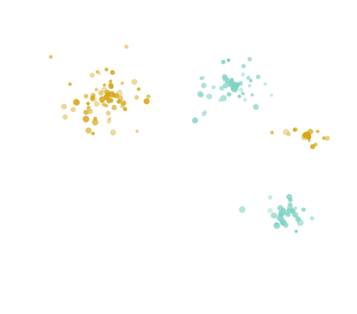

```{=html}
<section class="capa capa-interna">
  
  <div class="miolo">
    <span class="selo">Passo a passo</span>
    <h1>Como abrir o notebook no Google Colab</h1>
    <p class="subtitulo">Siga estes passos no início de cada encontro. Use o notebook do encontro do dia: <code style="color:#EAC830;background:transparent">minicurso_encontro1.ipynb</code> no dia 23 e <code style="color:#EAC830;background:transparent">minicurso_encontro2.ipynb</code> no dia 24.</p>
    <div class="botoes">
      <a class="botao botao-ouro" href="https://drive.google.com/drive/folders/18C-KbPA4nBWo01NBkJicDQ2Vx72pEjAT?usp=sharing">
        <svg viewBox="0 0 24 24" fill="none" stroke="currentColor" stroke-width="2" stroke-linecap="round" stroke-linejoin="round"><path d="M20 20a2 2 0 0 0 2-2V8a2 2 0 0 0-2-2h-7.9a2 2 0 0 1-1.69-.9L9.6 3.9A2 2 0 0 0 7.93 3H4a2 2 0 0 0-2 2v13a2 2 0 0 0 2 2Z"/></svg>
        <span>Pasta do minicurso no Drive</span>
      </a>
    </div>
  </div>
</section>

<section class="faixa">
  <div class="miolo-estreito">
    <div class="sobretitulo">Nove passos</div>
    <h2 class="titulo-secao">Do link ao notebook pronto</h2>
    <p class="lead-texto" style="margin-bottom:2.25rem">Os nomes em itálico são os da interface em inglês. Trabalhe sempre na sua cópia do notebook, criada no passo 7. A primeira célula de código prepara o ambiente da sessão.</p>
    <ol class="passos">
      <li>É necessária uma conta Google.</li>
      <li>Abra no navegador o link da <a href="https://drive.google.com/drive/folders/18C-KbPA4nBWo01NBkJicDQ2Vx72pEjAT?usp=sharing">pasta do minicurso</a>.</li>
      <li>Faça login com a sua conta Google, se o navegador pedir.</li>
      <li>Na pasta, escolha o arquivo do encontro do dia e use a opção "Abrir com" <span class="ingles">(Open with)</span> &gt; "Google Colaboratory".</li>
      <li>Se "Google Colaboratory" não aparecer na lista, use "Conectar mais apps" <span class="ingles">(Connect more apps)</span>, procure "Colaboratory", clique em "Instalar" <span class="ingles">(Install)</span> e repita o passo 4.</li>
      <li>Com o notebook aberto no Colab, feche o painel "Release Notes" do lado direito, se ele aparecer.</li>
      <li>Use o menu "Arquivo" <span class="ingles">(File)</span> &gt; "Salvar uma cópia no Drive" <span class="ingles">(Save a copy in Drive)</span>. A cópia abre numa nova aba com o nome começando por "Cópia de" <span class="ingles">(Copy of)</span>. Trabalhe sempre nessa cópia.</li>
      <li>Confira o menu "Ambiente de execução" <span class="ingles">(Runtime)</span> &gt; "Alterar o tipo de ambiente de execução" <span class="ingles">(Change runtime type)</span>. O tipo deve ser "R" e o acelerador deve ser "CPU". Clique em "Salvar" <span class="ingles">(Save)</span>.</li>
      <li>Execute logo a primeira célula de código do notebook, a da configuração do ambiente. Ela leva cerca de 4 minutos.</li>
    </ol>
  </div>
</section>

<section class="faixa faixa-clara">
  <div class="miolo-estreito">
    <div class="sobretitulo">Atalho</div>
    <h2 class="titulo-secao">Abrir direto no Colab</h2>
    <p class="lead-texto" style="margin-bottom:1.75rem">Os botões abaixo abrem o notebook do encontro direto no Colab, com login na conta Google. Eles substituem os passos 2 a 5 da lista acima. Em seguida, continue a partir do passo 6.</p>
    <div class="botoes">
      <a class="botao botao-azul" href="https://colab.research.google.com/drive/1d7Kp9wMVB456GIA99KxzvefH40CNMoYC">Encontro 1 no Colab</a>
      <a class="botao botao-azul" href="https://colab.research.google.com/drive/1Q7U6X_Jxs4skmHT4zvU2W6wmEQ7yQ8ZT">Encontro 2 no Colab</a>
    </div>
  </div>
</section>
```
