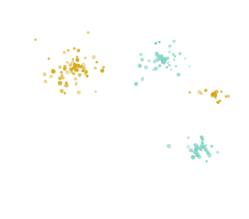

```{=html}
<section class="capa capa-interna">
  
  <div class="miolo">
    <span class="selo">Encontro 1 de 2</span>
    <h1>Da matriz de contagens ao UMAP</h1>
    <div class="meta">
      <div class="meta-item"><span class="rot">Data</span><span class="val">Segunda, 23 de novembro de 2026</span></div>
      <div class="meta-item"><span class="rot">Horário</span><span class="val">08:00 às 10:00</span></div>
      <div class="meta-item"><span class="rot">Conteúdo</span><span class="val">8 blocos · 87 slides</span></div>
    </div>
    <div class="botoes">
      <a class="botao botao-ouro" href="https://colab.research.google.com/drive/1d7Kp9wMVB456GIA99KxzvefH40CNMoYC"><svg viewBox="0 0 24 24" fill="none" stroke="currentColor" stroke-width="2" stroke-linecap="round" stroke-linejoin="round"><path d="M5 12h14"/><path d="m13 5 7 7-7 7"/></svg><span>Abrir notebook no Colab</span></a>
      <a class="botao botao-vazado" href="slides/encontro1.html"><svg viewBox="0 0 24 24" fill="none" stroke="currentColor" stroke-width="2" stroke-linecap="round" stroke-linejoin="round"><rect x="2" y="3" width="20" height="14" rx="2"/><path d="M8 21h8"/><path d="M12 17v4"/></svg><span>Slides em tela cheia</span></a>
      <a class="botao botao-vazado" href="https://drive.google.com/file/d/1d7Kp9wMVB456GIA99KxzvefH40CNMoYC/view"><svg viewBox="0 0 24 24" fill="none" stroke="currentColor" stroke-width="2" stroke-linecap="round" stroke-linejoin="round"><path d="M20 20a2 2 0 0 0 2-2V8a2 2 0 0 0-2-2h-7.9a2 2 0 0 1-1.69-.9L9.6 3.9A2 2 0 0 0 7.93 3H4a2 2 0 0 0-2 2v13a2 2 0 0 0 2 2Z"/></svg><span>Notebook no Drive</span></a>
    </div>
  </div>
</section>

<section class="faixa">
  <div class="miolo">
    <div class="sobretitulo">Slides</div>
    <h2 class="titulo-secao">Teoria do encontro 1</h2>
    <div class="moldura-slides"><iframe src="slides/encontro1.html" title="Slides do encontro 1" loading="lazy" allowfullscreen></iframe></div>
    <p class="dica">Clique nos slides e use <kbd>←</kbd> <kbd>→</kbd> para navegar, <kbd>F</kbd> para tela cheia e <kbd>O</kbd> para a visão geral.</p>
  </div>
</section>

<section class="faixa faixa-clara">
  <div class="miolo">
    <div class="sobretitulo">Prática</div>
    <h2 class="titulo-secao">Pontos de verificação</h2>
    <p class="lead-texto" style="margin-bottom:1.75rem">Cada bloco do notebook termina com uma linha <code>VERIFICACAO</code>. Compare a saída da sua sessão com o valor desta tabela. O tempo previsto para a prática aparece junto de cada bloco.</p>
    <div class="rolagem"><table class="tabela-verif">
<thead><tr><th>Bloco</th><th>Tema</th><th>Prática</th><th>O que você deve ver</th></tr></thead>
<tbody>
<tr><td><span class="cod">B00</span></td><td>Configuração do ambiente</td><td>8 min</td><td><code>VERIFICACAO B00: 6.0.0</code></td></tr>
<tr><td><span class="cod">B01</span></td><td>Entrada de dados</td><td>7 min</td><td><code>VERIFICACAO B01: 33539x6249</code></td></tr>
<tr><td><span class="cod">B02a</span></td><td>Objeto Seurat e doublets<span class="resgate">resgate CP0</span></td><td>11 min</td><td><code>VERIFICACAO B02a: 20271x3949</code></td></tr>
<tr><td><span class="cod">B02b</span></td><td>Métricas de qualidade e filtragem</td><td>10 min</td><td><code>VERIFICACAO B02b: 20271x3541</code></td></tr>
<tr><td><span class="cod">B03</span></td><td>Normalização, genes variáveis e escalonamento<span class="resgate">resgate CP1</span></td><td>6 min</td><td><code>VERIFICACAO B03: 2000</code></td></tr>
<tr><td><span class="cod">B04</span></td><td>PCA e comparações</td><td>7 min</td><td><code>VERIFICACAO B04: 3541x50</code></td></tr>
<tr><td><span class="cod">B05</span></td><td>Normalização alternativa (SCTransform)<span class="resgate">resgate CP2</span></td><td>7 min</td><td><code>VERIFICACAO B05: RNA+SCT</code></td></tr>
<tr><td><span class="cod">B06</span></td><td>UMAP</td><td>10 min</td><td><code>VERIFICACAO B06: pca+SCT.pca+umap</code></td></tr>
</tbody></table></div>
  </div>
</section>

<section class="faixa">
  <div class="miolo-estreito">
    <div class="sobretitulo">Se algo der errado</div>
    <h2 class="titulo-secao">Pontos de resgate</h2>
    <div class="aviso"><svg viewBox="0 0 24 24" fill="none" stroke="currentColor" stroke-width="2" stroke-linecap="round" stroke-linejoin="round"><circle cx="12" cy="12" r="10"/><path d="M12 16v-4"/><path d="M12 8h.01"/></svg><p>Se você ficar para trás em um bloco, continue a execução até o fim do tempo de prática. No bloco seguinte que tiver célula de resgate, troque <code>FALSE</code> por <code>TRUE</code> nessa célula e execute. O resgate recupera os objetos, não os pacotes, por isso o bloco de configuração precisa ter sido executado na sessão atual.</p></div>
    <div class="botoes" style="margin-top:2rem">
      <a class="botao botao-azul" href="como-abrir.html">Como abrir no Colab</a>
      <a class="botao botao-claro" href="encontro-2.html">Ir para o encontro 2</a>
    </div>
  </div>
</section>
```
