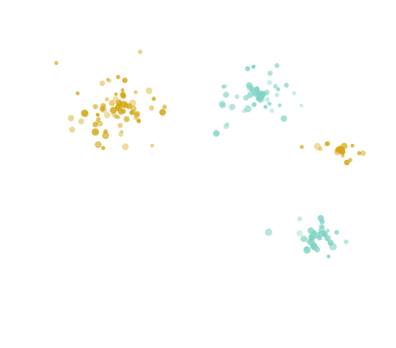

```{=html}
<section class="capa capa-interna">
  
  <div class="miolo">
    <span class="selo">Encontro 2 de 2</span>
    <h1>Do agrupamento à interpretação biológica</h1>
    <div class="meta">
      <div class="meta-item"><span class="rot">Data</span><span class="val">Terça, 24 de novembro de 2026</span></div>
      <div class="meta-item"><span class="rot">Horário</span><span class="val">08:00 às 10:00</span></div>
      <div class="meta-item"><span class="rot">Conteúdo</span><span class="val">7 blocos · 91 slides</span></div>
    </div>
    <div class="botoes">
      <a class="botao botao-ouro" href="https://colab.research.google.com/drive/1Q7U6X_Jxs4skmHT4zvU2W6wmEQ7yQ8ZT"><svg viewBox="0 0 24 24" fill="none" stroke="currentColor" stroke-width="2" stroke-linecap="round" stroke-linejoin="round"><path d="M5 12h14"/><path d="m13 5 7 7-7 7"/></svg><span>Abrir notebook no Colab</span></a>
      <a class="botao botao-vazado" href="slides/encontro2.html"><svg viewBox="0 0 24 24" fill="none" stroke="currentColor" stroke-width="2" stroke-linecap="round" stroke-linejoin="round"><rect x="2" y="3" width="20" height="14" rx="2"/><path d="M8 21h8"/><path d="M12 17v4"/></svg><span>Slides em tela cheia</span></a>
      <a class="botao botao-vazado" href="https://drive.google.com/file/d/1Q7U6X_Jxs4skmHT4zvU2W6wmEQ7yQ8ZT/view"><svg viewBox="0 0 24 24" fill="none" stroke="currentColor" stroke-width="2" stroke-linecap="round" stroke-linejoin="round"><path d="M20 20a2 2 0 0 0 2-2V8a2 2 0 0 0-2-2h-7.9a2 2 0 0 1-1.69-.9L9.6 3.9A2 2 0 0 0 7.93 3H4a2 2 0 0 0-2 2v13a2 2 0 0 0 2 2Z"/></svg><span>Notebook no Drive</span></a>
    </div>
  </div>
</section>

<section class="faixa">
  <div class="miolo">
    <div class="sobretitulo">Slides</div>
    <h2 class="titulo-secao">Teoria do encontro 2</h2>
    <div class="moldura-slides"><iframe src="slides/encontro2.html" title="Slides do encontro 2" loading="lazy" allowfullscreen></iframe></div>
    <p class="dica">Clique nos slides e use <kbd>←</kbd> <kbd>→</kbd> para navegar, <kbd>F</kbd> para tela cheia e <kbd>O</kbd> para a visão geral.</p>
  </div>
</section>

<section class="faixa faixa-clara">
  <div class="miolo">
    <div class="sobretitulo">Prática</div>
    <h2 class="titulo-secao">Pontos de verificação</h2>
    <p class="lead-texto" style="margin-bottom:1.75rem">Cada bloco do notebook termina com uma linha <code>VERIFICACAO</code>. Compare a saída da sua sessão com o valor desta tabela. O tempo previsto para a prática aparece junto de cada bloco.</p>
    <div class="rolagem"><table class="tabela-verif">
<thead><tr><th>Bloco</th><th>Tema</th><th>Prática</th><th>O que você deve ver</th></tr></thead>
<tbody>
<tr><td><span class="cod">R00</span></td><td>Retomada e configuração<span class="resgate">carrega CP3</span></td><td>8 min</td><td><code>VERIFICACAO R00: 20271x3541</code></td></tr>
<tr><td><span class="cod">B07</span></td><td>Agrupamento e resolução</td><td>12 min</td><td><code>VERIFICACAO B07: 3</code></td></tr>
<tr><td><span class="cod">B08</span></td><td>Genes marcadores</td><td>12 min</td><td><code>VERIFICACAO B08: 11/10246</code></td></tr>
<tr><td><span class="cod">B09</span></td><td>Expressão diferencial<span class="resgate">resgate CP4</span></td><td>9 min</td><td><code>VERIFICACAO B09: 23516</code></td></tr>
<tr><td><span class="cod">B10</span></td><td>Anotação automatizada</td><td>9 min</td><td><code>VERIFICACAO B10: 14</code></td></tr>
<tr><td><span class="cod">B11</span></td><td>Anotação manual<span class="resgate">resgate CP5</span></td><td>7 min</td><td><code>VERIFICACAO B11: 7</code></td></tr>
<tr><td><span class="cod">B12</span></td><td>Enriquecimento GO</td><td>6 min</td><td><code>VERIFICACAO B12: 649</code></td></tr>
</tbody></table></div>
  </div>
</section>

<section class="faixa">
  <div class="miolo-estreito">
    <div class="sobretitulo">Se algo der errado</div>
    <h2 class="titulo-secao">Pontos de resgate</h2>
    <div class="aviso"><svg viewBox="0 0 24 24" fill="none" stroke="currentColor" stroke-width="2" stroke-linecap="round" stroke-linejoin="round"><circle cx="12" cy="12" r="10"/><path d="M12 16v-4"/><path d="M12 8h.01"/></svg><p>O bloco R00 executa a configuração e carrega o objeto do encontro 1 a partir do ponto de resgate CP3, por isso não é preciso ter concluído o encontro anterior. Se você ficar para trás em um bloco, continue a execução até o fim do tempo de prática. No bloco seguinte que tiver célula de resgate, troque <code>FALSE</code> por <code>TRUE</code> nessa célula e execute.</p></div>
    <div class="botoes" style="margin-top:2rem">
      <a class="botao botao-azul" href="como-abrir.html">Como abrir no Colab</a>
      <a class="botao botao-claro" href="encontro-1.html">Ir para o encontro 1</a>
    </div>
  </div>
</section>
```
