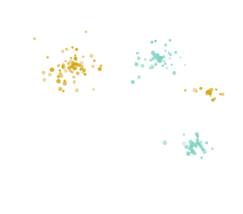
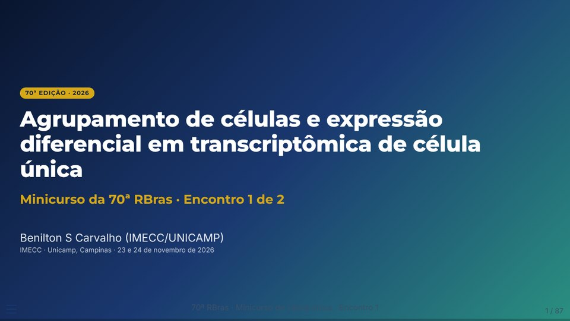
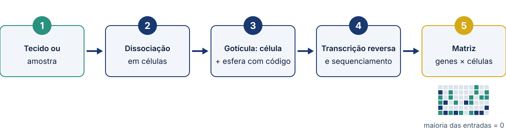

```{=html}
<section class="capa">
  
  <div class="miolo">
    <span class="selo">70ª RBras · Minicurso</span>
    <h1>Agrupamento de células e expressão diferencial em transcriptômica de célula única</h1>
    <p class="subtitulo">Uma introdução prática à análise de dados de transcriptômica de célula única, com atenção especial ao agrupamento das células e à identificação de genes diferencialmente expressos.</p>
    <div class="meta">
      <div class="meta-item"><span class="rot">Datas</span><span class="val">23 e 24 de novembro de 2026</span></div>
      <div class="meta-item"><span class="rot">Horário</span><span class="val">08:00 às 10:00</span></div>
      <div class="meta-item"><span class="rot">Local</span><span class="val">Sala 253 · IMECC/UNICAMP</span></div>
      <div class="meta-item"><span class="rot">Docente</span><span class="val">Benilton S Carvalho</span></div>
    </div>
    <div class="botoes">
      <a class="botao botao-ouro" id="botao-do-dia" href="encontro-1.html">
        <svg viewBox="0 0 24 24" fill="none" stroke="currentColor" stroke-width="2" stroke-linecap="round" stroke-linejoin="round"><path d="M5 12h14"/><path d="m13 5 7 7-7 7"/></svg>
        <span>Encontro 1: slides e notebook</span>
      </a>
      <a class="botao botao-vazado" href="como-abrir.html">
        <svg viewBox="0 0 24 24" fill="none" stroke="currentColor" stroke-width="2" stroke-linecap="round" stroke-linejoin="round"><path d="M4 19.5v-15A2.5 2.5 0 0 1 6.5 2H20v20H6.5a2.5 2.5 0 0 1 0-5H20"/></svg>
        <span>Como abrir no Colab</span>
      </a>
    </div>
  </div>
</section>

<section class="faixa">
  <div class="miolo">
    <div class="sobretitulo">Sobre o minicurso</div>
    <h2 class="titulo-secao">Da matriz de contagens às populações celulares</h2>
    <p class="lead-texto">Este minicurso faz uma introdução prática à análise de dados de transcriptômica de célula única, com atenção especial ao agrupamento das células e à identificação de genes diferencialmente expressos. Os participantes percorrerão o caminho que vai da matriz de contagens até a definição das populações celulares e sua caracterização biológica. A análise de agrupamento e a expressão diferencial são os momentos em que os resultados ganham sentido, realizando uma ponte entre metodologias estatísticas e interpretação biológica, exatamente quando as células deixam de ser pontos em um gráfico e passam a representar tipos e estados que podem ser lidos à luz da biologia do tecido estudado.</p>
    <p class="lead-texto">Este minicurso é desenhado para audiência ampla e equilibra explicações curtas e exercícios guiados. A meta é que, no fim, cada participante entenda por que cada passo é dado e consiga avaliar as próprias decisões, do ajuste da resolução do agrupamento até a leitura de uma lista de marcadores. Como todo o trabalho é feito sobre um conjunto de dados real, do começo ao fim, cada pessoa termina o curso com um fluxo pronto para reaproveitar em seus próprios projetos.</p>

    <div class="grade grade-3" style="margin-top:2.5rem">
      <div class="destaque">
        <div class="icone"><svg viewBox="0 0 24 24" fill="none" stroke="currentColor" stroke-width="2" stroke-linecap="round" stroke-linejoin="round"><path d="M17.5 19H9a7 7 0 1 1 6.71-9h1.79a4.5 4.5 0 1 1 0 9Z"/></svg></div>
        <h4>Sem instalação</h4>
        <p>R com o pacote Seurat, executado inteiramente no Google Colab.</p>
      </div>
      <div class="destaque">
        <div class="icone"><svg viewBox="0 0 24 24" fill="none" stroke="currentColor" stroke-width="2" stroke-linecap="round" stroke-linejoin="round"><circle cx="7" cy="8" r="2.5"/><circle cx="16" cy="7" r="2"/><circle cx="12" cy="16" r="3"/><circle cx="19" cy="15" r="1.5"/></svg></div>
        <h4>Dados reais</h4>
        <p>Amostra GSM4339769 (C141) da série GSE145926 do GEO, do começo ao fim.</p>
      </div>
      <div class="destaque">
        <div class="icone"><svg viewBox="0 0 24 24" fill="none" stroke="currentColor" stroke-width="2" stroke-linecap="round" stroke-linejoin="round"><circle cx="12" cy="12" r="10"/><path d="M2 12h20"/><path d="M12 2a15.3 15.3 0 0 1 4 10 15.3 15.3 0 0 1-4 10 15.3 15.3 0 0 1-4-10 15.3 15.3 0 0 1 4-10z"/></svg></div>
        <h4>Material aberto</h4>
        <p>Derivado do scNotebooks: revisado por pares, em português, espanhol, inglês e chinês.</p>
      </div>
    </div>
  </div>
</section>

<section class="faixa faixa-clara" id="encontros">
  <div class="miolo">
    <div class="sobretitulo">Material</div>
    <h2 class="titulo-secao">Os dois encontros</h2>
    <div class="grade grade-2" style="margin-top:1.75rem">
      <article class="cartao">
        <a class="cartao-imagem" href="encontro-1.html"><span class="etiqueta">Encontro 1</span></a>
        <div class="cartao-corpo">
          <span class="data">Segunda, 23 de novembro · 08:00</span>
          <h3>Da matriz de contagens ao UMAP</h3>
          <ul class="lista-blocos">
            <li>Configuração</li><li>Entrada de dados</li><li>Doublets</li><li>Qualidade e filtragem</li><li>Normalização</li><li>PCA</li><li>SCTransform</li><li>UMAP</li>
          </ul>
          <div class="botoes">
            <a class="botao botao-azul" href="encontro-1.html">Slides e notebook</a>
            <a class="botao botao-claro" href="https://colab.research.google.com/drive/1d7Kp9wMVB456GIA99KxzvefH40CNMoYC">Abrir no Colab</a>
          </div>
        </div>
      </article>
      <article class="cartao">
        <a class="cartao-imagem" href="encontro-2.html"><span class="etiqueta">Encontro 2</span></a>
        <div class="cartao-corpo">
          <span class="data">Terça, 24 de novembro · 08:00</span>
          <h3>Do agrupamento à interpretação biológica</h3>
          <ul class="lista-blocos">
            <li>Retomada</li><li>Agrupamento e resolução</li><li>Genes marcadores</li><li>Expressão diferencial</li><li>Anotação automatizada</li><li>Anotação manual</li><li>Enriquecimento GO</li>
          </ul>
          <div class="botoes">
            <a class="botao botao-azul" href="encontro-2.html">Slides e notebook</a>
            <a class="botao botao-claro" href="https://colab.research.google.com/drive/1Q7U6X_Jxs4skmHT4zvU2W6wmEQ7yQ8ZT">Abrir no Colab</a>
          </div>
        </div>
      </article>
    </div>
  </div>
</section>

<section class="faixa">
  <div class="miolo">
    <div class="sobretitulo">Visão geral</div>
    <h2 class="titulo-secao">O caminho da análise</h2>
    <div class="figura-fluxo"></div>
  </div>
</section>

<section class="faixa faixa-clara">
  <div class="miolo-estreito">
    <div class="sobretitulo">Antes de começar</div>
    <h2 class="titulo-secao">Tenha uma conta Google à mão</h2>
    <div class="aviso">
      <svg viewBox="0 0 24 24" fill="none" stroke="currentColor" stroke-width="2" stroke-linecap="round" stroke-linejoin="round"><circle cx="12" cy="12" r="10"/><path d="M12 16v-4"/><path d="M12 8h.01"/></svg>
      <p>Os notebooks rodam no Google Colab, no nível gratuito, sem instalação no seu computador. Para abri-los é necessária uma conta Google. O passo a passo completo está na página <a href="como-abrir.html">Como abrir no Colab</a>.</p>
    </div>
  </div>
</section>

<section class="faixa">
  <div class="miolo-estreito">
    <div class="sobretitulo">Referências</div>
    <h2 class="titulo-secao">Para ir além do minicurso</h2>
    <p>Os notebooks do minicurso derivam do Módulo 04 do <a href="https://github.com/integrativebioinformatics/scNotebooks">scNotebooks</a>, na versão em português. O scNotebooks reúne materiais abertos que o participante pode revisitar sozinho depois dos encontros. Os dados vêm da série <a href="https://www.ncbi.nlm.nih.gov/geo/query/acc.cgi?acc=GSE145926">GSE145926</a> do GEO.</p>
    <div class="referencia">Rojas-Hidalgo A, Arias-Carrasco R, Silva JK, et al. The Single Cell Notebooks for inclusive and accessible training in single-cell and spatial omics. <em>Nature Genetics</em> 58, 1189-1194 (2026). <a href="https://doi.org/10.1038/s41588-026-02584-0">https://doi.org/10.1038/s41588-026-02584-0</a></div>
  </div>
</section>

<script>
(function () {
  try {
    var agora = new Date();
    var virada = new Date("2026-11-23T12:00:00-03:00");
    if (agora >= virada) {
      var b = document.getElementById("botao-do-dia");
      b.href = "encontro-2.html";
      b.querySelector("span").textContent = "Encontro 2: slides e notebook";
    }
  } catch (e) {}
})();
</script>
```
