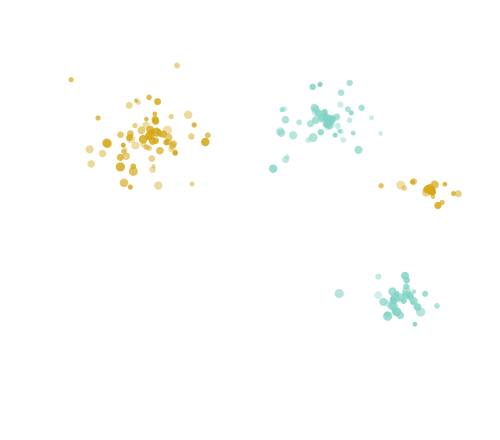

```{=html}
<section class="capa capa-interna">
  
  <div class="miolo">
    <span class="selo">Programa</span>
    <h1>Quatro horas em dois encontros</h1>
    <p class="subtitulo">Cada bloco começa com a teoria nos slides e segue com a prática no notebook do Colab.</p>
    <div class="meta">
      <div class="meta-item"><span class="rot">Local</span><span class="val">Sala 253 · IMECC/UNICAMP</span></div>
      <div class="meta-item"><span class="rot">Início</span><span class="val">08:00 nos dois dias</span></div>
      <div class="meta-item"><span class="rot">Blocos</span><span class="val">15</span></div>
    </div>
  </div>
</section>

<section class="faixa">
  <div class="miolo grade grade-2" style="gap:3rem">
    <div>
      <div class="cabeca-encontro"><h3>Encontro 1</h3><span class="quando">Segunda, 23 de novembro</span></div>
      <ol class="agenda">
<li class="marco"><span class="hora">08:00</span><span class="ponto"></span><div class="item"><span class="nome">Abertura</span><span class="tempos"><b>4 min</b></span></div></li>
<li><span class="hora">08:04</span><span class="ponto"></span><div class="item"><span class="cod">B00</span><span class="nome">Configuração do ambiente</span><span class="tempos">teoria <b>4 min</b> · prática <b>8 min</b></span></div></li>
<li><span class="hora">08:16</span><span class="ponto"></span><div class="item"><span class="cod">B01</span><span class="nome">Entrada de dados</span><span class="tempos">teoria <b>4 min</b> · prática <b>7 min</b></span></div></li>
<li><span class="hora">08:27</span><span class="ponto"></span><div class="item"><span class="cod">B02a</span><span class="nome">Objeto Seurat e doublets</span><span class="tempos">teoria <b>4 min</b> · prática <b>11 min</b></span></div></li>
<li><span class="hora">08:42</span><span class="ponto"></span><div class="item"><span class="cod">B02b</span><span class="nome">Métricas de qualidade e filtragem</span><span class="tempos">teoria <b>5 min</b> · prática <b>10 min</b></span></div></li>
<li><span class="hora">08:57</span><span class="ponto"></span><div class="item"><span class="cod">B03</span><span class="nome">Normalização, genes variáveis e escalonamento</span><span class="tempos">teoria <b>5 min</b> · prática <b>6 min</b></span></div></li>
<li><span class="hora">09:08</span><span class="ponto"></span><div class="item"><span class="cod">B04</span><span class="nome">PCA e comparações</span><span class="tempos">teoria <b>5 min</b> · prática <b>7 min</b></span></div></li>
<li><span class="hora">09:20</span><span class="ponto"></span><div class="item"><span class="cod">B05</span><span class="nome">Normalização alternativa (SCTransform)</span><span class="tempos">teoria <b>4 min</b> · prática <b>7 min</b></span></div></li>
<li><span class="hora">09:31</span><span class="ponto"></span><div class="item"><span class="cod">B06</span><span class="nome">UMAP</span><span class="tempos">teoria <b>5 min</b> · prática <b>10 min</b></span></div></li>
<li class="marco"><span class="hora">09:46</span><span class="ponto"></span><div class="item"><span class="nome">Fechamento</span><span class="tempos"><b>3 min</b></span></div></li>
</ol>
      <div class="botoes" style="margin-top:1.5rem"><a class="botao botao-azul" href="encontro-1.html">Slides e notebook do encontro 1</a></div>
    </div>
    <div>
      <div class="cabeca-encontro"><h3>Encontro 2</h3><span class="quando">Terça, 24 de novembro</span></div>
      <ol class="agenda">
<li><span class="hora">08:00</span><span class="ponto"></span><div class="item"><span class="cod">R00</span><span class="nome">Retomada e configuração</span><span class="tempos">teoria <b>4 min</b> · prática <b>8 min</b></span></div></li>
<li><span class="hora">08:12</span><span class="ponto"></span><div class="item"><span class="cod">B07</span><span class="nome">Agrupamento e resolução</span><span class="tempos">teoria <b>8 min</b> · prática <b>12 min</b></span></div></li>
<li><span class="hora">08:32</span><span class="ponto"></span><div class="item"><span class="cod">B08</span><span class="nome">Genes marcadores</span><span class="tempos">teoria <b>7 min</b> · prática <b>12 min</b></span></div></li>
<li><span class="hora">08:51</span><span class="ponto"></span><div class="item"><span class="cod">B09</span><span class="nome">Expressão diferencial</span><span class="tempos">teoria <b>6 min</b> · prática <b>9 min</b></span></div></li>
<li><span class="hora">09:06</span><span class="ponto"></span><div class="item"><span class="cod">B10</span><span class="nome">Anotação automatizada</span><span class="tempos">teoria <b>5 min</b> · prática <b>9 min</b></span></div></li>
<li><span class="hora">09:20</span><span class="ponto"></span><div class="item"><span class="cod">B11</span><span class="nome">Anotação manual</span><span class="tempos">teoria <b>4 min</b> · prática <b>7 min</b></span></div></li>
<li><span class="hora">09:31</span><span class="ponto"></span><div class="item"><span class="cod">B12</span><span class="nome">Enriquecimento GO</span><span class="tempos">teoria <b>5 min</b> · prática <b>6 min</b></span></div></li>
<li class="marco"><span class="hora">09:42</span><span class="ponto"></span><div class="item"><span class="nome">Fechamento</span><span class="tempos"><b>3 min</b></span></div></li>
</ol>
      <div class="botoes" style="margin-top:1.5rem"><a class="botao botao-azul" href="encontro-2.html">Slides e notebook do encontro 2</a></div>
    </div>
  </div>
</section>
```
